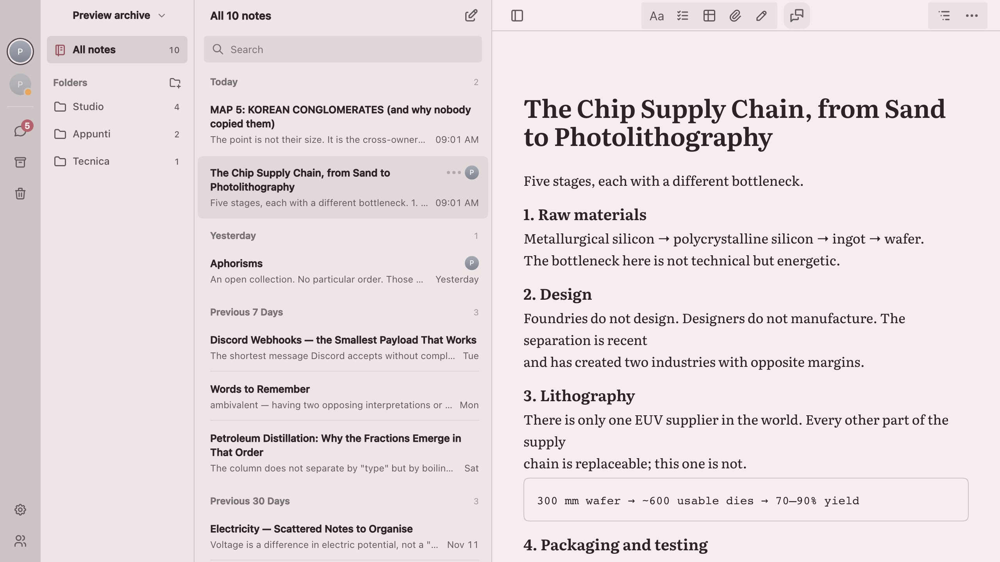
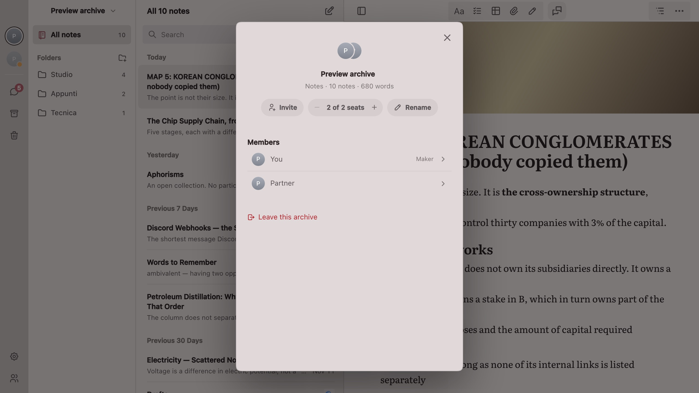
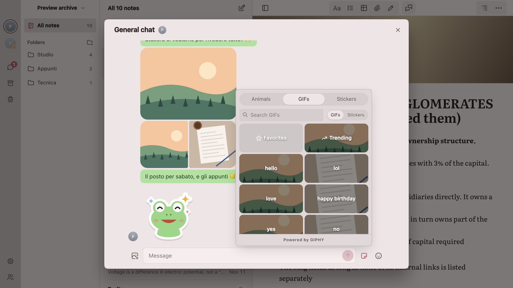
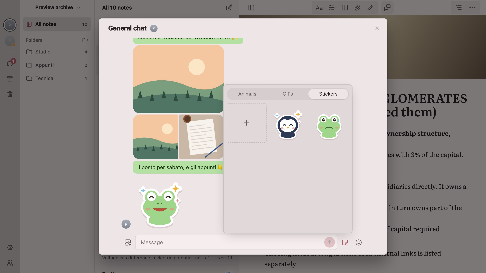
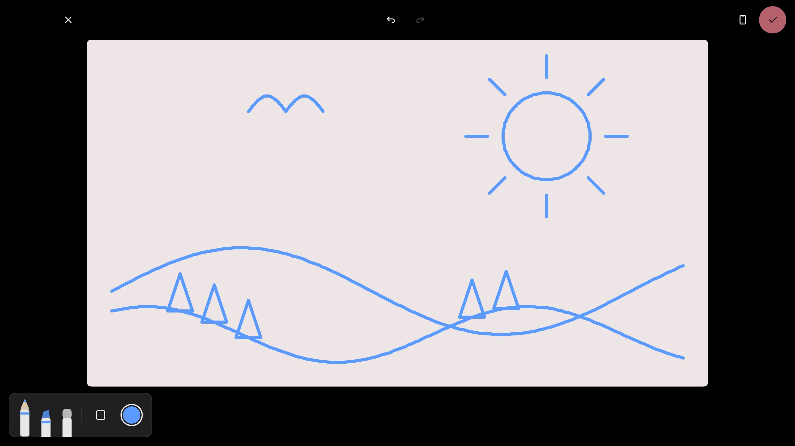
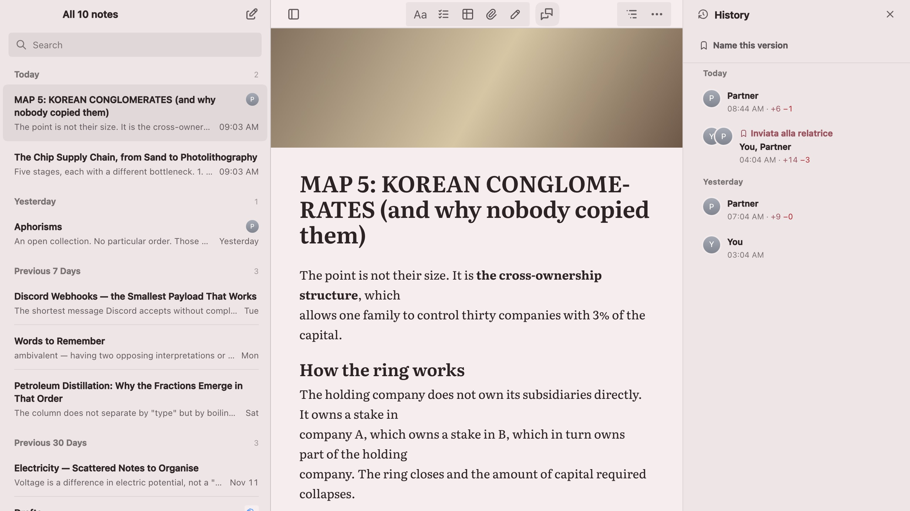
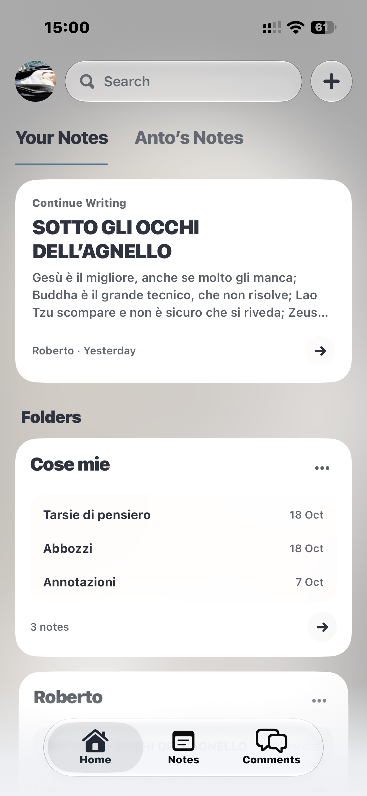
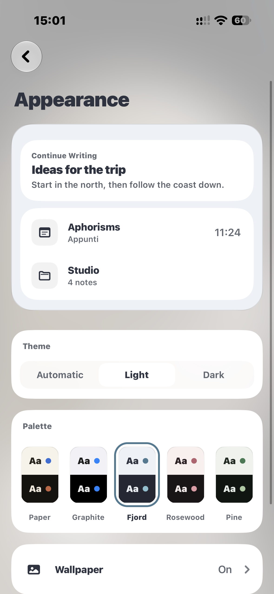

# Napp

Notes you write together, with a chat beside them – in your browser and on your
desktop. **Coming soon to your phone.**



## Notes and the editor

Rich text, checklists, tables, links, images and attachments, organised in
folders with pins, search, Archive and Trash. The people in your archive edit
the same note live; lock a note or a passage to keep control of its writing.

## An archive shared with its people



Each archive has its own members, folders and notes – personal notes, a study
group, shared writing. One account can belong to several archives, and an
archive holds up to eight members. Invitations expire after seven days.

## The chat



Every archive has a general chat, and every note its own. Send photos, which
open full size, animal stickers and GIFs from shelves by mood. Star the ones you
use most to keep them in Favorites.



Add your own pictures, still or animated, to the archive's sticker pack. Only
the people in that archive see them.

## Drawing



Draw on the page or on a board with pencil, marker and eraser.

## History



Earlier versions of a note, by author and time, plus the versions you name
yourself. Restoring one keeps the present as a named version first.

## Download

| Client      | Availability                                                                                                                                                                          |
| ----------- | ------------------------------------------------------------------------------------------------------------------------------------------------------------------------------------- |
| **Web**     | [Open Napp in your browser](https://nappnote.com/).                                                                                                                                   |
| **macOS**   | [Apple Silicon](https://github.com/Jacopo792/napp/releases/latest/download/Napp-mac-arm64.dmg) · [Intel](https://github.com/Jacopo792/napp/releases/latest/download/Napp-mac-x64.dmg) |
| **Windows** | [Download the installer](https://github.com/Jacopo792/napp/releases/latest/download/Napp-windows-setup.exe)                                                                           |

Installers are currently unsigned; [the desktop guide](DESKTOP.md) covers
installation. Release history is in [CHANGELOG.md](CHANGELOG.md).

## Coming soon to your phone

Napp for iPhone and Android is on the way, with a native interface built around
touch. Mobile downloads are not available yet; news will appear in
[GitHub Releases](https://github.com/Jacopo792/napp/releases).

<table>
  <tr>
    <td width="33%" align="center"></td>
    <td width="33%" align="center"></td>
    <td width="33%" align="center"></td>
  </tr>
</table>

Captured on an iPhone from the app in development. The mobile client is
developed separately; its source is not in this repository.

## Privacy and access

Archive membership is enforced by Postgres Row Level Security and by the
collaboration server. Notes are access-controlled, **not end-to-end encrypted**.
See [SECURITY.md](SECURITY.md) for the access model, local data and
vulnerability reporting.

## How the project is structured

Napp is a TypeScript pnpm monorepo. The application logic and editor live in one
core; each client supplies the platform integration it needs.

| Path                      | Responsibility                                                                                                     |
| ------------------------- | ------------------------------------------------------------------------------------------------------------------ |
| `packages/core/`          | Shared domain logic, web/desktop interface, rich-text editor, collaboration client, account flows and preferences. |
| `apps/web/`               | Vite browser entry point, published to GitHub Pages.                                                               |
| `apps/desktop/`           | Electron shell, operating-system integration and macOS/Windows packaging.                                          |
| `packages/collab-server/` | Hocuspocus server, live-document authorisation, persistence, version history and health checks.                    |
| `supabase/`               | Database migrations, RLS policies, Storage rules and account-deletion functions.                                   |
| `e2e/`                    | Browser smoke tests and full-stack tests against disposable local data.                                            |
| `ops/`                    | Expected collaboration-server origins checked against deployment configuration.                                    |

React, TanStack Router, Vite and Tailwind CSS provide the web/desktop interface.
Tiptap edits Yjs documents; Hocuspocus distributes live changes and persists them
in Postgres. Redis/Valkey connects overlapping server instances. Supabase supplies
Auth, Postgres, Realtime and private Storage.

Architecture boundaries are checked by ESLint: core cannot import a client shell,
and the web and desktop shells mount the same application rather than
implementing separate editors. Notes have a structured Tiptap representation and
a plain-text projection for search and previews; Markdown is an exchange format.

The [workspace and editor map](docs/workspace-editor.md) identifies the owner of
each feature, its state and the checks to run before changing it.

## Development

Use Node.js from [`.nvmrc`](.nvmrc) and pnpm 11 or later.

```bash
cp .env.example .env.local
pnpm install
pnpm dev            # web
pnpm dev:desktop    # Electron
```

Set the public client configuration in `.env.local`:

```dotenv
VITE_SUPABASE_URL=
VITE_SUPABASE_PUBLISHABLE_KEY=
VITE_COLLAB_URL=ws://127.0.0.1:8080
VITE_WEB_ORIGIN=http://localhost:5173/
```

Use a Supabase project with the repository's migrations applied, or start a local
stack with the Supabase CLI and Docker. Run the collaboration server separately;
it reads its configuration from the process environment:

```bash
export SUPABASE_URL="http://127.0.0.1:54321"
export SUPABASE_PUBLISHABLE_KEY="<local-publishable-or-anon-key>"
export SUPABASE_SERVICE_ROLE_KEY="<local-service-role-key>"
export ALLOWED_ORIGINS="http://localhost:5173,http://localhost:5174,app://notes"
# Optional for a single instance; required when instances overlap:
# export REDIS_URL="redis://127.0.0.1:6379"
pnpm --filter @notes-app/collab-server start
```

The service-role key belongs only to server processes. Never place it in a
`VITE_*` variable or a client bundle.

### Google Drive import on the web and desktop

In a Notes archive, open the menu at the top of the note list and choose **Import from Google Drive**. Choose files, then review the destination and its members before importing. Google Docs become editable notes. Sheets, Slides and PDFs become private PDF attachments, each in its own note. Google Workspace exports through this integration have a [10 MB limit](https://developers.google.com/workspace/drive/api/reference/rest/v3/files/export).

Set up a Google Cloud project with the Drive and Picker APIs enabled, an OAuth Web application client with the Napp origin under **Authorized JavaScript origins**, and a browser API key restricted to that origin and the Picker API. Use the same project for all three values and configure the consent screen for the per-file scope `https://www.googleapis.com/auth/drive.file`. In testing mode, add the Google account you’ll use to test. [Google Picker setup](https://developers.google.com/workspace/drive/picker/guides/web-picker)

Set `VITE_GOOGLE_DRIVE_CLIENT_ID`, `VITE_GOOGLE_DRIVE_API_KEY` and `VITE_GOOGLE_DRIVE_PROJECT_NUMBER` in the root `.env.local` for development and as GitHub Actions variables for GitHub Pages. The project number is numeric. Authorize origins without paths, such as `http://localhost:5173` and `https://nappnote.com`. The browser build exposes these identifiers, so keep any OAuth client secret out of the build. The import action appears when all three values are set.

For Electron, create a dedicated **Desktop app** OAuth client in the same project. Set `VITE_GOOGLE_DRIVE_DESKTOP_CLIENT_ID` and `GOOGLE_DRIVE_DESKTOP_CLIENT_SECRET` in the root `.env.local`. For releases, set the ID as a GitHub Actions variable and the installed-app client secret as a GitHub Actions secret. The native client credential ships as an Electron resource and is used by the main process for the token exchange. Use the credential from the dedicated Desktop client. Napp opens Google Picker in the system browser and receives the selection on a temporary loopback callback protected by PKCE. [Google Picker for desktop](https://developers.google.com/workspace/drive/picker/guides/desktop-mobile-picker)

### Interface preview without a backend

```bash
pnpm preview:ui
# pnpm preview:desktop-ui
```

The web preview runs at [localhost:5199](http://localhost:5199) with in-memory demo
data and accepts any credentials. Preview data does not prove backend permissions
or persistence.

## Checks and tests

```bash
pnpm healthcheck                 # format, lint, types, core/SQL tests and web build
pnpm exec playwright install chromium
pnpm test:e2e                    # UI smoke tests with preview data
supabase start
pnpm test:e2e:full               # real Auth, RLS and collaboration on local fixtures
```

`pnpm test:server` runs the collaboration-server suite. Start local Supabase and
Valkey for integration coverage; `REQUIRE_INTEGRATION=1` makes missing dependencies
fail instead of skipping those tests. The CI backend job supplies both services.

CI checks formatting, types, unit and database logic, collaboration behavior,
full-stack browser flows and web/desktop builds.
The browser suite covers persistence, access denial, invitations, offline
reconnection, version restore, deletion and cache removal. Failures retain traces
and screenshots. These checks establish their tested scope, rather than a
guarantee about every environment or future deployment.

The [quality guide](docs/quality-hardening.md) records the verified scope and
remaining release checks.

## Documentation

| Guide                                | Contents                                                   |
| ------------------------------------ | ---------------------------------------------------------- |
| [Product](PRODUCT.md)                | Scope and behaviour.                                       |
| [Design](DESIGN.md)                  | Interface rules and design decisions.                      |
| [Desktop](DESKTOP.md)                | Installation and troubleshooting.                          |
| [Repository guide](CLAUDE.md)        | Architecture, development and release conventions.         |
| [Security](SECURITY.md)              | Access boundaries, local data and vulnerability reporting. |
| [Quality](docs/quality-hardening.md) | Automated coverage and validation limits.                  |
| [Changelog](CHANGELOG.md)            | Release history.                                           |

## Licence

Napp's source is available under the Functional Source License 1.1 with an
Apache 2.0 future licence ([FSL-1.1-ALv2](LICENSE)): you may read, run, modify
and share it for any purpose except offering a competing product or service.
Each version becomes Apache 2.0 two years after its release. Versions released
before this change remain under the GPL, version 3 or later.

The Napp name and logo are not licensed with the code; see
[TRADEMARK.md](TRADEMARK.md).
