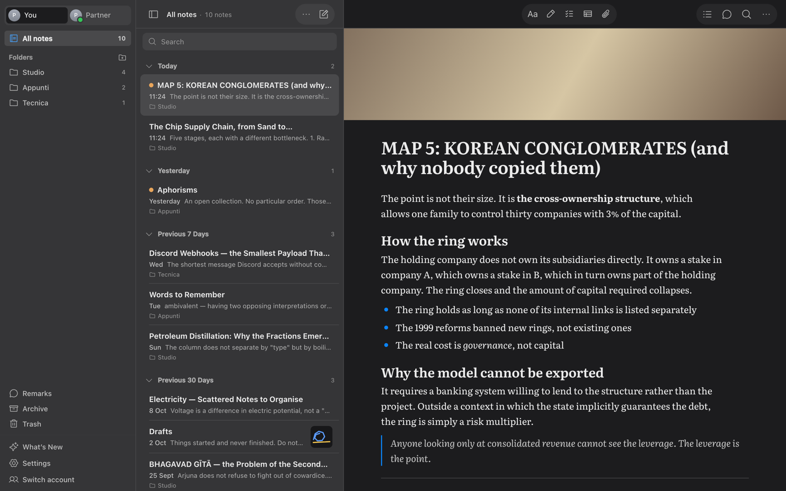
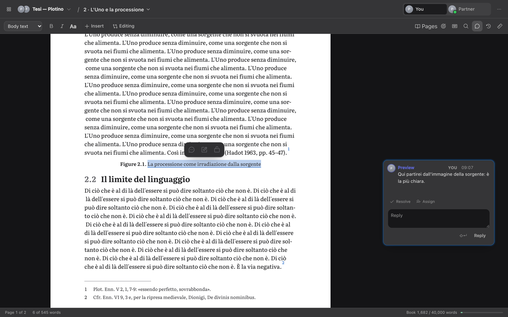
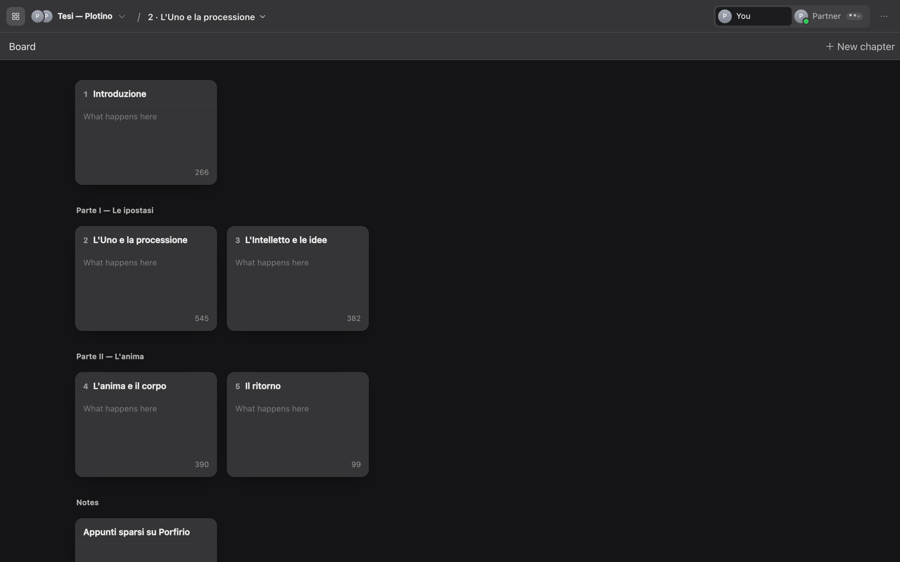
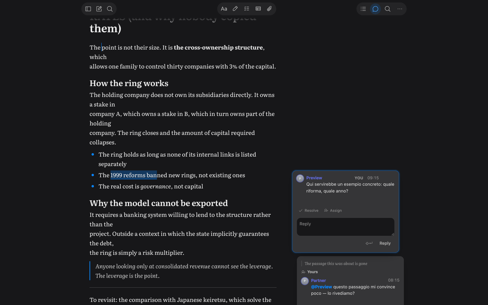
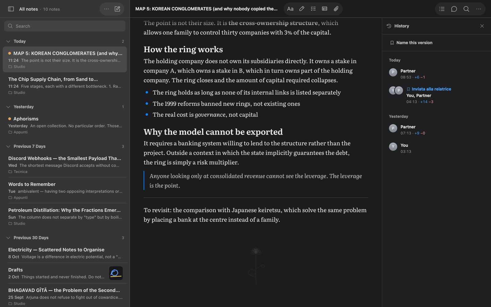
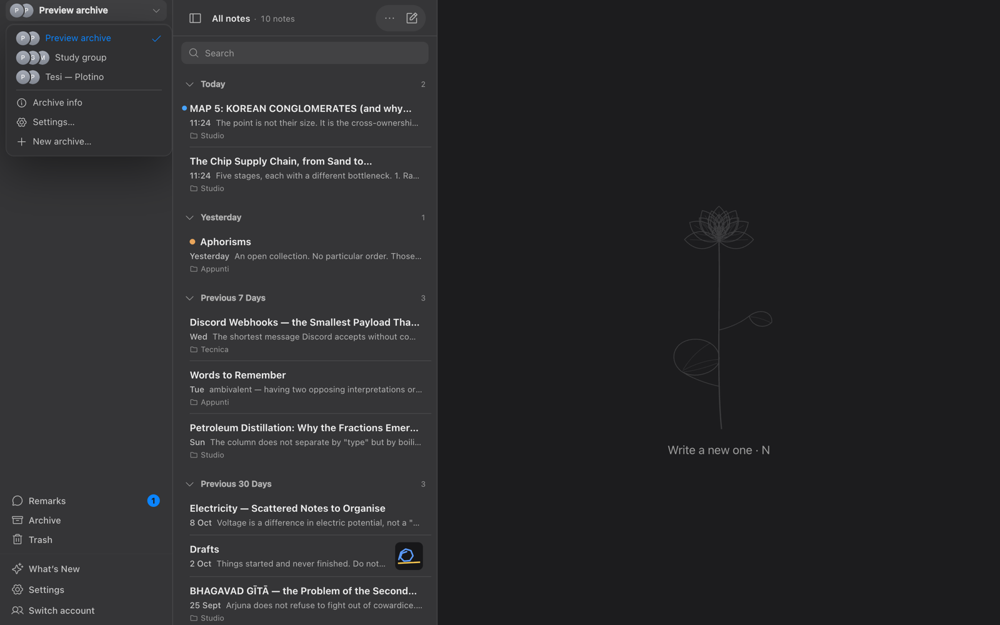
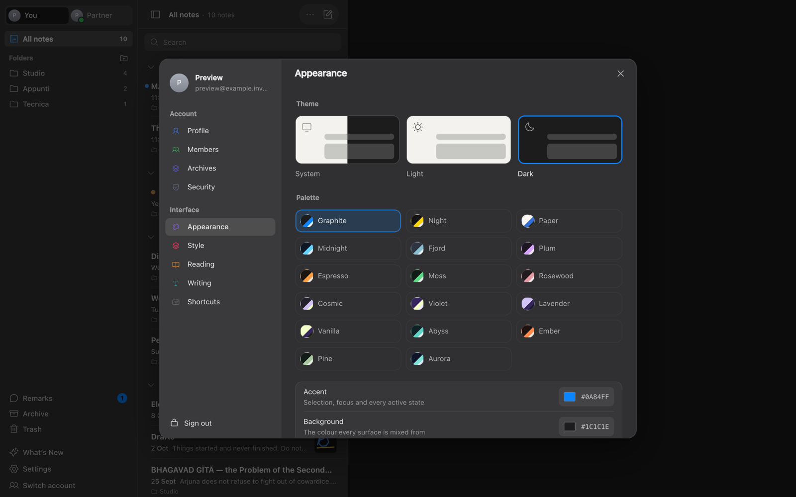
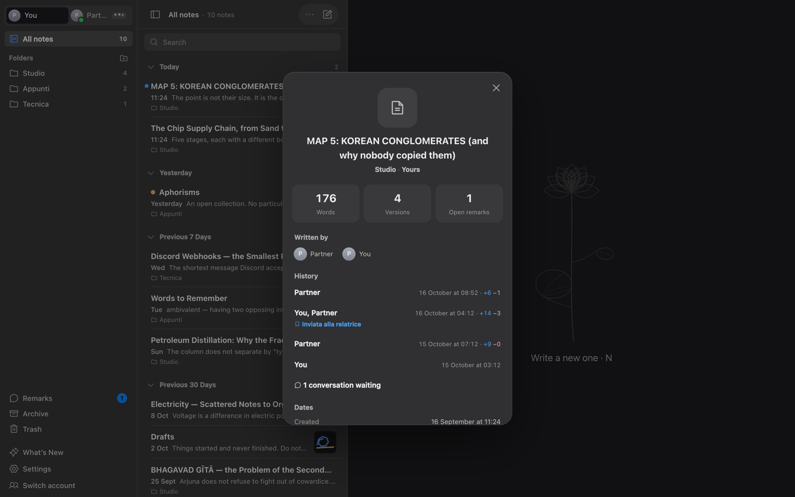

# Napp

A place for notes, shared writing and longer work – in your browser and on your
desktop.



## Why I built it

Writing is lonely work. For years I wrote on my own, in a diary nobody else would
ever open, and I kept wondering how good it would be if someone could look over my
shoulder – read what I had just written, stop on a sentence, tell me what they
thought of it.

Napp began there. It has grown into a workspace for everything from a quick note
to a thesis or a book, while keeping that original idea: the people you choose can
write beside you, see the words arrive and leave a remark where it belongs.

## What you can do

- **Write and organise.** Rich text, checklists, tables, links, drawings, images
  and attachments, with folders, pins, search, Archive and Trash.
- **Share a space.** Create several archives, invite people to the ones you want
  to share, and edit the same note live. An archive can hold up to eight members.
  Lock a note or a passage when you want to keep control of its writing.
- **Have a conversation beside the words.** Comment on a passage, reply, react,
  assign a thread and resolve it. Unread remarks lead back to the relevant note.
- **Keep the history.** Compare earlier versions, name a moment worth keeping and
  restore it while preserving the current version first.
- **Make room for longer work.** Book archives on web and desktop add chapters,
  parts, an organising board, word goals, footnotes, captions, cross-references
  and a printable page. Themes, covers and reading settings make the workspace
  your own; Markdown import/export and PDF tools help move work in and out.

Already-open collaborative notes remain editable during a disconnect and merge
with the archive after reconnecting. This is recovery for work in progress;
opening an archive still depends on its account and access checks.

## Use Napp

| Client      | Availability                                                                                                                                                                          |
| ----------- | ------------------------------------------------------------------------------------------------------------------------------------------------------------------------------------- |
| **Web**     | [Open Napp in your browser](https://jacopo792.github.io/napp/).                                                                                                                       |
| **macOS**   | [Apple Silicon](https://github.com/Jacopo792/napp/releases/latest/download/Napp-mac-arm64.dmg) · [Intel](https://github.com/Jacopo792/napp/releases/latest/download/Napp-mac-x64.dmg) |
| **Windows** | [Download the installer](https://github.com/Jacopo792/napp/releases/latest/download/Napp-windows-setup.exe)                                                                           |

The desktop clients share the web application's interface, with native menus,
file actions, keyboard shortcuts and an unread-comment badge. Installers are
currently unsigned; [the desktop guide](DESKTOP.md) covers installation and
troubleshooting.

A separate mobile client is under development. Its source is not included on the
`main` branch.

## A workspace for longer writing



A Book archive is laid out like the page it will be printed on. The book and
chapter stay in view, with word counts and goals close to the writing. Chapters
and parts also have a board: arrange cards, describe what happens in each one and
change its status without opening the page.



## Conversations and versions



Select a passage and leave a remark. When the window has room, the conversation
stands in the margin beside the words it is about. Replies, reactions and resolved
threads stay attached to that context.



History keeps earlier stretches of writing and the versions you name yourself.
Restoring an earlier version keeps the present as a named version first.

## Your spaces, your settings



One account can belong to several archives: personal notes, a study group, shared
writing or a book. Each archive has its own members, folders and organisation.
Invitations come from **Settings → Members** and expire after seven days.



Choose a palette, colours, wallpaper and reading settings. Preferences follow the
account across browsers and desktop clients. A note, folder or person's sheet
brings related details and activity together.



## Accounts, access and local data

Supabase Auth identifies accounts; Postgres Row Level Security enforces archive
membership. The collaboration server checks access when a note is opened and
while its connection remains active. Note and passage locks protect writing,
not secrecy from other members who can already read the note.

The app includes password recovery, account deletion, content reporting and user
blocking. Deletion removes the account's own data while preserving work belonging
to other members. Abuse reports have a separate moderation workflow.

Explicit sign-out asks before removing local copies, including unsynced edits.
Automatic locking and account switching retain collaborative document stores for
recovery. Stored documents are **not end-to-end encrypted**. Production email
configuration and moderation operations still require operational setup; the
[security guide](SECURITY.md) records those limits.

See [SECURITY.md](SECURITY.md) for the access model, cache policy, current limits
and private vulnerability reporting.

## How the project is structured

Napp is a TypeScript pnpm monorepo. The application logic and editor live in one
core; each client supplies the platform integration it needs.

| Path                      | Responsibility                                                                                                     |
| ------------------------- | ------------------------------------------------------------------------------------------------------------------ |
| `packages/core/`          | Shared domain logic, web/desktop interface, rich-text editor, collaboration client, account flows and preferences. |
| `apps/web/`               | Vite browser entry point, published to GitHub Pages.                                                               |
| `apps/desktop/`           | Electron shell, operating-system integration and macOS/Windows packaging.                                          |
| `packages/collab-server/` | Hocuspocus server, live-document authorisation, persistence, version history and health checks.                    |
| `supabase/`               | Database migrations, RLS policies, Storage rules and account-deletion functions.                                   |
| `e2e/`                    | Browser smoke tests and full-stack tests against disposable local data.                                            |
| `ops/`                    | Expected collaboration-server origins checked against deployment configuration.                                    |

React, TanStack Router, Vite and Tailwind CSS provide the web/desktop interface.
Tiptap edits Yjs documents; Hocuspocus distributes live changes and persists them
in Postgres. Redis/Valkey connects overlapping server instances. Supabase supplies
Auth, Postgres, Realtime and private Storage.

Architecture boundaries are checked by ESLint: core cannot import a client shell,
and the web and desktop shells mount the same application rather than
implementing separate editors. Notes have a structured Tiptap representation and
a plain-text projection for search and previews; Markdown is an exchange format.

## Development

Use Node.js from [`.nvmrc`](.nvmrc) and pnpm 11 or later.

```bash
cp .env.example .env.local
pnpm install
pnpm dev            # web
pnpm dev:desktop    # Electron
```

Set the public client configuration in `.env.local`:

```dotenv
VITE_SUPABASE_URL=
VITE_SUPABASE_PUBLISHABLE_KEY=
VITE_COLLAB_URL=ws://127.0.0.1:8080
VITE_WEB_ORIGIN=http://localhost:5173/
```

Use a Supabase project with the repository's migrations applied, or start a local
stack with the Supabase CLI and Docker. Run the collaboration server separately;
it reads its configuration from the process environment:

```bash
export SUPABASE_URL="http://127.0.0.1:54321"
export SUPABASE_PUBLISHABLE_KEY="<local-publishable-or-anon-key>"
export SUPABASE_SERVICE_ROLE_KEY="<local-service-role-key>"
export ALLOWED_ORIGINS="http://localhost:5173,http://localhost:5174,app://notes"
# Optional for a single instance; required when instances overlap:
# export REDIS_URL="redis://127.0.0.1:6379"
pnpm --filter @notes-app/collab-server start
```

The service-role key belongs only to server processes. Never place it in a
`VITE_*` variable or a client bundle.

### Interface preview without a backend

```bash
pnpm preview:ui
# pnpm preview:desktop-ui
```

The web preview runs at [localhost:5199](http://localhost:5199) with in-memory demo
data and accepts any credentials. Preview data does not prove backend permissions
or persistence.

## Checks and tests

```bash
pnpm healthcheck                 # format, lint, types, core/SQL tests and web build
pnpm exec playwright install chromium
pnpm test:e2e                    # UI smoke tests with preview data
supabase start
pnpm test:e2e:full               # real Auth, RLS and collaboration on local fixtures
```

`pnpm test:server` runs the collaboration-server suite. Start local Supabase and
Valkey for integration coverage; `REQUIRE_INTEGRATION=1` makes missing dependencies
fail instead of skipping those tests. The CI backend job supplies both services.

CI checks formatting, types, unit and database logic, collaboration behavior,
full-stack browser flows and web/desktop builds.
The browser suite covers persistence, access denial, invitations, offline
reconnection, version restore, deletion and cache removal. Failures retain traces
and screenshots. These checks establish their tested scope, rather than a
guarantee about every environment or future deployment.

The [quality guide](docs/quality-hardening.md) records the verified scope and
remaining release checks.

## Releases and deployment

Web changes on `main` pass the CI gates before GitHub Pages is updated. The
collaboration service is deployed separately; its commit, readiness and accepted
origins are checked before the new web artifact is published when a server deploy
is requested. `render.yaml` documents the service configuration but does not apply
changes to the existing live service by itself.

Desktop release tags trigger macOS and Windows builds and publish the installers
to [GitHub Releases](https://github.com/Jacopo792/napp/releases). Version changes
also update the in-app What's New and [CHANGELOG.md](CHANGELOG.md). Database
migrations must precede clients that require them; destructive schema changes
must wait until older clients no longer depend on the removed fields.

## Documentation

| Guide                                | Contents                                                   |
| ------------------------------------ | ---------------------------------------------------------- |
| [Product](PRODUCT.md)                | Scope and behaviour.                                       |
| [Design](DESIGN.md)                  | Interface rules and design decisions.                      |
| [Desktop](DESKTOP.md)                | Installation and troubleshooting.                          |
| [Repository guide](CLAUDE.md)        | Architecture, development and release conventions.         |
| [Security](SECURITY.md)              | Access boundaries, local data and vulnerability reporting. |
| [Quality](docs/quality-hardening.md) | Automated coverage and validation limits.                  |
| [Changelog](CHANGELOG.md)            | Release history.                                           |

## Licence

Napp is licensed under the GNU General Public License, version 3 or later.
See [LICENSE](LICENSE).
